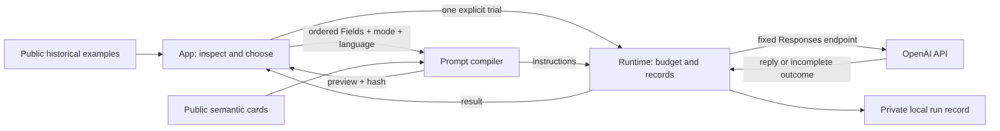

# Architecture and contracts

Private YAML is not an input to the public compiler or runtime. Maintainers interpret relevant source passages outside this repository, then propose public semantic cards. Private provenance remains outside the release tree. Public contributors can use and extend the entire app without those sources.

## App

`app.js` composes independent `signals.js`, `records.js` and `workbench.js` modules. The app has no external scripts or dependencies. Native SVG renders the same saved sample values; chart decisions and descriptive metrics are calculated locally. The observer uses an EMA with alpha 0.15 and a margin threshold; zero latent truth is not assigned a binary error rate.

Navigation, interface language, and the ordered prompt composition (Fields, format and prompt language) are stored in browser local storage. Trial input, replies and API credentials are not stored there. Model-generated and recorded text is rendered as text, not HTML. Keyboard tab navigation, mobile layout, and reduced visual complexity keep the existing observation workflow accessible.

## Prompt layer

`base.en.md` and `base.ja.md` supply common instructions. Schema v2 in `fields.json` pairs English/Japanese scopes and response moves under each stable Field ID. `presets.json` composes ordered Field IDs. `compile_prompt` accepts a preset or explicit ordered selection, validates both locales and all references, and returns instructions, selected IDs, language, mode and SHA-256. Unknown languages, unknown/duplicate IDs and empty non-baseline selections fail validation. Explicit selections override presets; an exact ordered match retains that preset name, otherwise it is `custom`.

The app's download envelope is not a provider request. The runtime maps `instructions` into the Responses API request and supplies the trial input separately. These are system-style response instructions, not operating-system permissions or a claim about the model's hidden system prompt.

`baseline` has no selected Field moves. `plain` and `structured` use identical scopes, moves and ordering; the latter additionally contains names and JSON syntax. They remain different full prompts and token lengths.

## Runtime

`provider.py` accepts one input up to 4000 characters, a preset or ordered Field selection, a prompt language, one mode and a model identifier. It caps output at 1200 tokens (600 by default), supports a per-process request budget of 1–18 (3 by default), and serializes dispatches with a lock. No history, tools, redirects, provider fallback or retry is added.

`Session` writes an exclusive request and dispatch marker before a call, consumes the slot before dispatch, and stops on failure, incomplete output, empty output or detected credential echo. A transport failure may still have reached the provider; delivery and usage can be unknown. A crash can leave a dispatch marker without a result. These are incomplete records, not success or permission to resend.

Every dispatch preserves the selected prompt language and ordered IDs alongside the exact instructions and hash. Each successful persistence sequence contains `request.json`, `dispatch.json`, `result.json`, and a hash-binding `receipt.json`. File modes are 0600 and new run directories are 0700. Request bodies and replies can be private. The secret credential is never recorded. Exact checks prevent the current credential from being used as input or persisted if echoed; they are not a general-purpose secret detector.

`server.py` binds only to 127.0.0.1. It serves only the app, public data and prompt assets, checks the Host header, and requires matching Origin plus an in-memory nonce for POSTs. Runtime sources, `.runs/`, Git metadata and arbitrary files are not routes. This is a local research tool, not an authenticated multi-user production service.

## Reproducibility boundaries

The source environment reproduces all five displayed samples with exact numeric equality. `verify-signals` retains that strict check. Linux CI uses `verify-signals --portable` because Gaussian noise generation uses platform math functions. It checks the recorded file hashes, metadata and array lengths, and reports the largest absolute difference across all samples. Every difference must be finite and at most 1e-14. All latent signs (including zero) and every decision at each configured threshold must agree.

Dialogue cases and historical API replies retain their original wording. The historical pilot used source-bearing instructions. Each public trial gets its own record linked to the instructions by hash.
