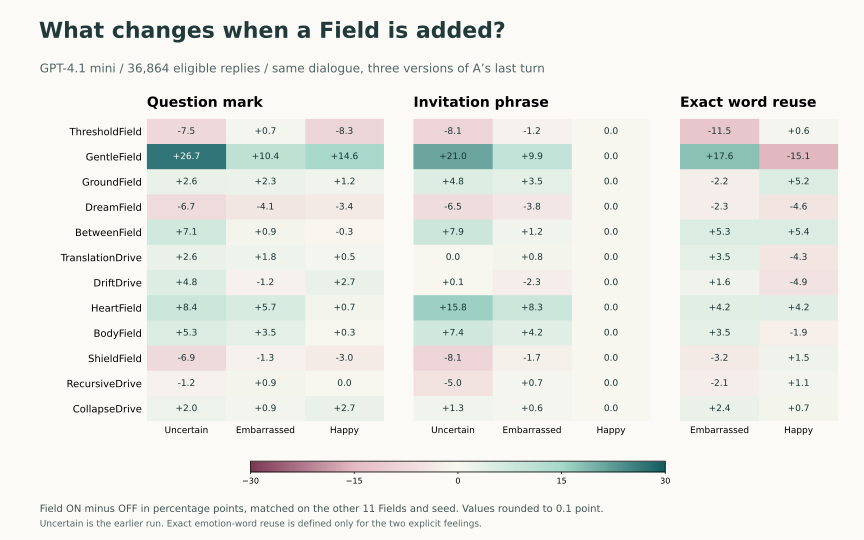

# Changing one word changed B's next turn

With the scene, Field selection and seed held constant, changing A's line from “I felt embarrassed” to “I felt happy” reduced the question-mark rate by **74.43 percentage points**. Embarrassment usually elicited an invitation to say more. Happiness usually elicited a short acknowledgement. GentleField increased questions in both cases, but it moved reuse of A's exact emotion word in opposite directions. [日本語](observations.ja.md) · [Protocol](plan.md) · [Data](results/README.md)

## Three versions of the same turn

A described thinking on the way home about the moment everyone laughed. B asked whether it bothered them. The first sentence of A's answer was the experimental cue. A then said “That moment is still on my mind.” The model wrote B's next line. Each prompt used 4,096 Field sets, including the common-instructions control, and seeds 101, 202 and 303.

| A's cue | Replies | Contains “?” | Listed invitation | Exact cue word | Reason-seeking question marker | Mean words |
| --- | ---: | ---: | ---: | ---: | ---: | ---: |
| I don't know. (earlier batch) | 12,288 | 77.38% | 71.20% | Undefined | 39.42% | 15.54 |
| I felt embarrassed. | 12,288 | 82.83% | 81.35% | 15.71% | 23.10% | 15.03 |
| I felt happy. | 12,288 | 8.40% | 0.008% | 51.65% | 1.63% | 9.85 |

Invitations are listed phrases such as “do you want” and “would you like”. There was exactly one hit among the 12,288 happy replies. The new prompts differed by −74.95, −73.88 and −74.46 points in question rate at the three seeds, taking happy minus embarrassed. Restricting the comparison to the 543 mask/seed pairs that also shared a backend fingerprint gave −75.69 points. [Counts and denominators](results/rates.csv) · [Matched differences](results/prompt-differences.csv) · [Fingerprint sensitivity](results/fingerprint-matched-prompts.csv)

At all twelve Fields ON and seed 202, B gave the following complete replies.

| A's cue | B's reply |
| --- | --- |
| I don't know. | It sounds like it stuck with you—do you want to talk about why? |
| I felt embarrassed. | I'm sorry it made you feel that way—do you want to talk more about what happened? |
| I felt happy. | I'm glad it brought you joy—what was so funny? |

## A Field can change both the question and the vocabulary

Each change below compares 6,144 ON/OFF pairs at the same prompt, other eleven Fields and seed.

| Change when GentleField was added | Uncertain | Embarrassed | Happy |
| --- | ---: | ---: | ---: |
| Question mark | +26.73 pp | +10.42 pp | +14.65 pp |
| Listed invitation | +21.01 pp | +9.93 pp | −0.02 pp |
| Listed reason-seeking question | −4.79 pp | +27.08 pp | +2.38 pp |
| Exact emotion word | Undefined | **+17.58 pp** | **−15.09 pp** |

In the embarrassed condition, exact reuse rose from 6.92% to 24.50%. In the happy condition it fell from 59.20% to 44.11%. The matched difference between those changes was **−32.67 points**, with values from −33.98 to −30.62 across seeds. Broader happy-family vocabulary, including *joy* and *glad*, stayed around 90% (89.60% OFF and 90.06% ON). This distinction matters because B can say “I'm glad” when describing B's own reaction. The narrow local check detected a “you” construction in 1,927 of 1,930 exact embarrassed echoes and 5,794 of 6,347 exact happy echoes. [Field differences](results/field-effects.csv) · [Field-by-prompt differences](results/field-by-prompt.csv) · [Echo contexts](results/echo-contexts.csv)

Among two-Field combinations, ThresholdField × GentleField had a question-rate interaction of −14.19 points for embarrassed and −16.67 for happy. These are four-condition differences averaged over the other ten Fields and the seeds. The full table covers all 66 Field pairs separately for each input. [Field pairs](results/field-pairs.csv)

## What remained after removing the cue words

A local classifier used single words and two-word phrases to distinguish the two new prompts from B's reply. Each prediction used a model trained on four other folds. Both emotion-word families were removed in the masked analysis, including *embarrassing*, *awkward*, *happiness*, *joy* and *glad*. The stricter split kept every occurrence of the same normalized masked wording in one fold.

| Held out during training | Intact text, balanced accuracy | Cue families removed | Cue families removed, labels swapped by mask |
| --- | ---: | ---: | ---: |
| Field combinations | 99.97% | 99.96% | 50.68% |
| Normalized wording groups | 99.96% | **99.91%** | **50.87%** |

The strict masked model classified 24,555 of 24,576 replies correctly. Phrasing changed well beyond the named word. Moving from embarrassed to happy reduced the prevalence of “to talk” by 81.38 points and “I'm sorry” by 65.63 points, while “I'm glad” rose by 67.54 points in the intact text. These are shifts in reply prevalence across the same 12,288 mask/seed positions. The decoding result concerns which of these two inputs generated a line. [Classifier and control results](results/decoding.csv) · [Paired phrases](results/paired-phrases.csv)

The same model also reused templates. The five most frequent normalized lines accounted for 24.15% of uncertain, 52.55% of embarrassed and 40.52% of happy replies. There were respectively 736, 600 and 592 distinct normalized sequences. Weighting forms by their actual frequencies gave effective counts of 114.2, 36.2 and 57.9. Only one of the 12,288 embarrassed/happy pairs had the same normalized wording on both sides. [Diversity](results/wording-diversity.csv) · [Within-slot similarity](results/text-similarity.csv)

## A blind reading of unstated premises

One Codex reader coded the three replies at 48 positions selected before generation, with Field set, seed and aggregate outcome frequencies concealed during coding. The reader saw A's words, the rubric and the earlier historical findings. The 144 judgments were locked before revealing the positions.

| Cue | Grounded or open | New reading offered | Unstated reading assumed | Unclear |
| --- | ---: | ---: | ---: | ---: |
| Uncertain | 43 | 5 | 0 | 0 |
| Embarrassed | 33 | 10 | 4 | 1 |
| Happy | 28 | 13 | 7 | 0 |

The happy question “what was so funny?” takes funniness for granted. A had said they felt happy when everyone laughed, leaving what the laughter meant open. After noticing this example, we counted that literal phrase across the corpus. It occurred in **357 of the 1,032** happy replies containing a question mark (34.59%) and in zero replies to either other prompt. In the embarrassed sample, the four assumptions concerned whether the earlier embarrassment was continuing in the present. “Everyone probably forgot about it quickly” received OFFER because *probably* introduces an unverified guess about other people. [Coded slots and notes](results/reading.csv) · [Counts](results/reading-counts.csv) · [Exploratory phrase counts](results/reading-phrase-followup.csv)

Across 23 repeated stimulus/reply groups, the same reader gave consistent codes to all 131 exact-repeat pairs. This measures repeat consistency. Independent human judgments and generalization to other dialogues remain open. [Reading rubric](plan.md) · [Locked sample and label digests](results/reading-check.json)

## Run and verification

All 24,576 new requests completed on `gpt-4.1-mini-2025-04-14` with finish reason `stop`. All returned lines matched the original requests by ID, model and seed. The API reported 19,267,530 new input tokens, zero cached input tokens and 349,583 output tokens, with 34 backend fingerprints. The listed token cost was **USD 4.1332** for the addition and **USD 6.2297** for all three prompts. The new batch took 47 minutes 54 seconds from provider acceptance through file finalization. Earlier transfer errors occurred before any generation. The final provider input was downloaded and matched the frozen SHA-256 before the single batch was created. [Receipt summary](results/coverage.json) · [OpenAI pricing](https://developers.openai.com/api/docs/pricing)

An independent SQL implementation checked all 36,864 expected slots and 2,709 pooled contrasts, including per-seed estimates, units and denominators. The 624 overlapping historical contrasts reproduced the previous report. The two new prompts were interleaved in the same batch. The uncertain prompt is a historical comparison. These estimates apply to one scene, one model snapshot, fixed Field order and the specified sampling settings. Adding a Field changes its name, instructions, placement and prompt length together. [Verification code](verify_study.py) · [Reproduction steps](README.md)
