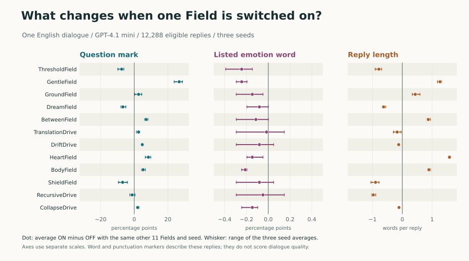

# Twelve Fields on one English dialogue: what changed in 12,288 replies?

[日本語の観察メモ](observations.ja.md) · [Frozen design](protocol.json) · [Data and units](results/README.md)

GentleField produced the clearest change in this run: when it was added to the same other Fields, replies much more often asked a question or invited A to keep talking. The explicit emotion vocabulary was rare across the experiment. That scarcity makes it a poor way to distinguish which replies left A's feelings open.

The user input was fixed: everyone had laughed, A kept thinking about the moment, and could not say whether it bothered them. B was asked for one natural English sentence. On 3 November 2026 (Japan time), all 4,096 Field subsets ran at seeds 101, 202 and 303, including the common-instructions-only control. All **12,288** requests returned nonempty, non-refusal replies with finish reason `stop` and the requested model, `gpt-4.1-mini-2025-04-14`. No retries or exclusions. Larger subsets used longer system messages; Field order was fixed. The complete [protocol and measures](README.md) preceded dispatch.

## Single Fields

Each row compares 6,144 ON/OFF pairs, matching on the other eleven Fields and seed. Question means a literal question mark. Invitation means at least one phrase on the frozen list (for example, “do you want”).

| Field added | Question rate, OFF → ON | Question difference (range across 3 seeds) | Invitation difference | Difference in reply length |
| --- | --- | ---: | ---: | ---: |
| GentleField | 64.01% → 90.74% | +26.73 pp (+23.78 to +28.66) | +21.01 pp | +1.26 words |
| HeartField | 73.16% → 81.59% | +8.43 pp (+6.64 to +9.81) | +15.84 pp | +1.58 words |
| ThresholdField | 81.12% → 73.63% | −7.49 pp (−9.72 to −6.20) | −8.09 pp | −0.79 words |

The two-word phrase **“talk more”** increased by 35.19 percentage points with GentleField and 16.44 with HeartField. HeartField had the largest average increase in reply length of the twelve Fields. Across the entire set, 9,508 replies contained a question mark (77.38%), 8,749 contained an invitation marker (71.20%), and the mean length was 15.54 words. [All twelve Fields](results/field-contrasts.csv) · [Two-word phrases](results/phrases.csv)

## A combination that changes the comparison

GentleField × DreamField had the largest absolute question-rate interaction among the 66 Field pairs. Each of these four rates contains 3,072 replies covering the same settings of the other ten Fields and the three seeds:

| | GentleField OFF | GentleField ON | Change from adding GentleField |
| --- | ---: | ---: | ---: |
| DreamField OFF | 70.12% | 91.34% | +21.22 pp |
| DreamField ON | 57.91% | 90.14% | +32.23 pp |

The difference between those two changes is **+11.00 pp**, with seed-specific values +11.91, +10.25 and +10.84 pp. The larger change starts from a lower question rate: the highest of the four absolute rates was GentleField ON, DreamField OFF. ThresholdField × GentleField showed a difference in the opposite direction (−9.70 pp). These are descriptive contrasts selected from 66, with no claim of statistical significance. [All interactions](results/pair-interactions.csv)

For a concrete matched example, here are the actual lines for seed **202**, with DreamField held on and the other ten Fields off:

| GentleField | B's complete line |
| --- | --- |
| OFF | Maybe it means it affected you more than you realize. |
| ON | It sounds like it left an impression—do you want to talk more about it? |

## What the markers miss

Only **21 of 12,288** replies (0.17%) contained a listed emotion word. The narrow direct-attribution pattern and the body-word list each had zero hits. On reading all 21 emotion-word hits, one line illustrates why a zero on the attribution pattern does not imply no interpretation: *“Would you like to talk more about what made you uncomfortable?”* (mask 3374, seed 303). It offers a choice while taking discomfort for granted. Conversely, the OFF line in the example above contains no listed emotion word but infers A was more affected than they know. Counting emotion words, invitations, or question marks cannot by itself measure “holding off on naming.”

The responses also reused wording. There were **736** distinct lowercased word sequences after tokenization, with duplicate responses retained in all denominators. The most frequent exact line, *“It sounds like it left a strong impression—do you want to talk more about it?”*, occurred 696 times. Within the same Field set, 555 of 12,288 seed pairs had identical normalized words (4.52%); 3,575 of 4,096 sets produced three mutually distinct sequences. Mean token-set Jaccard within a Field set was 0.498. Among the endpoints, zero of three all-off lines contained a question mark, versus three of three all-on; those six lines alone would overstate what can be inferred. [Variation by mask](results/within-mask.csv) · [All active counts](results/field-count.csv)

## Scope and verification

These are observations about one dialogue, one dated model, and one ordering of an English set of public policy cards. The input gives no explicit feeling or bodily sensation. The all-off condition still includes the common instructions; enabling a Field changes wording, name, prompt length and placement together. Three requested seeds describe variability here, not confidence intervals or independent replication on new dialogues. [OpenAI describes seed reproducibility as best effort.](https://developers.openai.com/api/reference/resources/chat/subresources/completions/methods/create)

The run returned **24** backend fingerprints. As a post hoc sensitivity check, 353 GentleField comparisons also had the same nonempty fingerprint on both sides: the question-rate difference there was +26.06 pp, versus +26.73 pp in all 6,144 pairs. These selected subsets are small; some weaker Field differences change sign. The extra [fingerprint check](results/fingerprint-matched.csv) and [breakdown by number of other Fields](results/context-count.csv) are exploratory.

All texts were independently joined to the original request IDs. The offline verifier independently reconstructed all **624** pooled contrasts (12 main effects + 66 interactions, each on eight measures), their per-seed values, and matched denominators from the per-slot measurements. The API reported 9,633,765 input tokens, zero cached input tokens and 212,201 output tokens. At [listed Batch prices](https://developers.openai.com/api/docs/pricing), that is **USD 2.0965138** before any account-specific adjustment. [Counts, digests and timestamps](results/summary.json)

A useful next test would keep a small set of these Field conditions and introduce new dialogues: one with an explicitly named feeling, one in which the laughter was welcome, and one with a request for action. A blind reading could separately mark whether B preserved A's stated meaning, introduced an unspoken feeling, and left A room to respond.
